  <picture>
    <source media="(prefers-color-scheme: dark)" srcset="./dark.svg">
    <source media="(prefers-color-scheme: light)" srcset="./light.svg">
    
  </picture>

<h1 align="center">Hi, I'm Rohit Kumar 👋</h1>

  <b>Full-Stack Developer · Java Learner · Software Engineering Enthusiast</b>

  💻 React / Next.js &nbsp;·&nbsp; ⚙️ Node.js / Express &nbsp;·&nbsp; ☕ Java
  &nbsp;·&nbsp; 🗄️ MongoDB &nbsp;·&nbsp; 🚀 Building practical web apps

I'm a B.Tech student who enjoys building **full-stack applications, interactive user experiences, and practical software projects**. I'm also improving my Java, DSA, and problem-solving skills as I work toward becoming a stronger software engineer.

---

## 💻 What I Build

- ⚛️ **Full-stack applications** — React, Next.js, Node.js and TypeScript
- ⚙️ **Backend APIs** — REST APIs, authentication and application workflows
- 🗄️ **Database-driven products** — MongoDB, MySQL and Firebase
- 🚀 **Interactive platforms** — responsive interfaces, dashboards and real-time features
- ☕ **Java & DSA** — building fundamentals through consistent practice

---

## 🧩 Featured Projects

### 🎬 [FlixGenie — AI-Powered Movie Discovery](https://github.com/rohit6522/FlixGenie)
Movie discovery platform built with React, Redux, Firebase Authentication, Firestore and the OMDb API.

[Live Demo](https://flixgenie-frontend.onrender.com)

### 🚗 [RYDEX — Vehicle Booking Platform](https://github.com/rohit6522/vehicle-booking-app)
Real-time vehicle booking platform built with Next.js, MongoDB, Socket.io and Razorpay.

[Live Demo](https://rydex-eo9t.onrender.com)

### 🏥 [Smart Hospital Emergency System](https://github.com/rohit6522/smart-hospital-emergency-system)
Hospital emergency management application with a React frontend and Spring Boot backend.

### 🛒 [Shopping Budget Tracker](https://github.com/rohit6522/Shopping-budget-tracker)
A project focused on shopping and budget tracking.

---

## 🛠️ Engineering Stack

  

---

## 📌 Currently Improving

- Java and data structures & algorithms
- Problem-solving and coding interview skills
- Backend development and system design fundamentals
- Building polished, responsive full-stack applications

---

## 📫 Connect With Me

- 🌐 **Portfolio:** [rohitworks.dev](https://www.rohitworks.dev)
- 💻 **GitHub:** [@rohit6522](https://github.com/rohit6522)

---

  <i>Keep learning. Keep building. Improve with every commit.</i>

